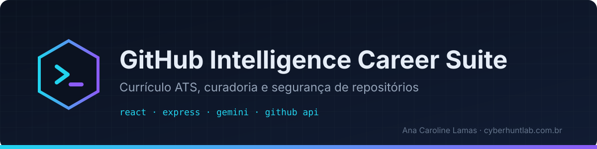

<p align="center"></p>

# GitHub Intelligence Career Suite — currículo, portfólio e curadoria do GitHub com IA

Aplicação full-stack (**React + Vite** e **Express**) que usa o **Google Gemini** para alinhar **currículo e portfólio no GitHub**. Ela sincroniza os repositórios do usuário, faz auditoria de qualidade e segurança (incluindo busca de segredos expostos), classifica cada projeto por relevância profissional, otimiza o currículo para **ATS** e gera ideias de projetos, README de perfil e documentos em PDF.

## Recursos

- **Conexão com o GitHub** por token e **sincronização em segundo plano** dos repositórios, com pausa e retomada.
- **Auditoria e segurança**:
  - busca de segredos expostos nos arquivos (`securityScanner`), com mascaramento;
  - análise de README, metadados, workflows e arquivos de backup esquecidos.
- **Curadoria de repositórios** (`/api/curation/*`): classificação por relevância profissional e recomendações, com reavaliação individual.
- **Ações no GitHub com confirmação**: alterar visibilidade, arquivar, abrir PR com o README de perfil e exportar pastas.
- **Currículo**: upload, extração do perfil profissional e otimização para ATS (`/api/resume/*`).
- **Ideias e projetos**: projetos de carreira, ideias de startup e projetos de hackathon, cada um com prompt de implementação.
- **Central de documentos**: currículos e relatórios exportados em PDF (jsPDF), com histórico.
- **Escolha automática de modelo**: testa uma lista de modelos Gemini e usa o primeiro disponível.

## Instalação

Requisitos: **Node.js 20+** e uma chave da API do **Gemini**.

```bash
git clone https://github.com/ticarollamas-arch/github-intelligence-career-suite-ai.git
cd github-intelligence-career-suite-ai
npm install
cp .env.example .env.local
```

| Variável | Uso |
|---|---|
| `GEMINI_API_KEY` | Chave da API do Google Gemini (obrigatória) |
| `APP_URL` | URL pública da aplicação (opcional) |

## Como usar

```bash
npm run dev        # servidor Express + Vite
npm run build      # build de produção
npm run lint       # checagem de tipos
```

1. Envie o currículo e revise o perfil extraído.
2. Conecte o GitHub com um token pessoal e inicie a sincronização.
3. Revise a curadoria e os alertas de segurança antes de aplicar qualquer ação.
4. Gere ideias de projetos, o README de perfil e os documentos em PDF.

> Ações como mudar a visibilidade ou arquivar repositórios alteram sua conta no GitHub. Revise cada recomendação e faça backup antes de aplicar.

Versão mais nova, integrada ao HACKMIND e ao portal ForgeLab: [forgelab-studio](https://github.com/ticarollamas-arch/forgelab-studio).

## Tecnologias

TypeScript · React 19 · Vite · Tailwind CSS · Motion · Express · Google Gemini (`@google/genai`) · GitHub REST API · jsPDF

## Licença

Distribuído sob a licença MIT. Veja [LICENSE](LICENSE).
